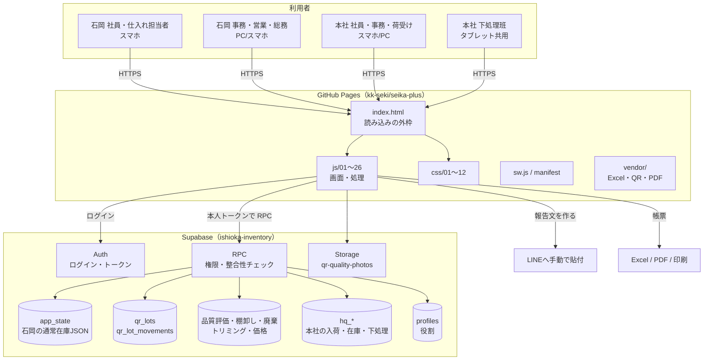
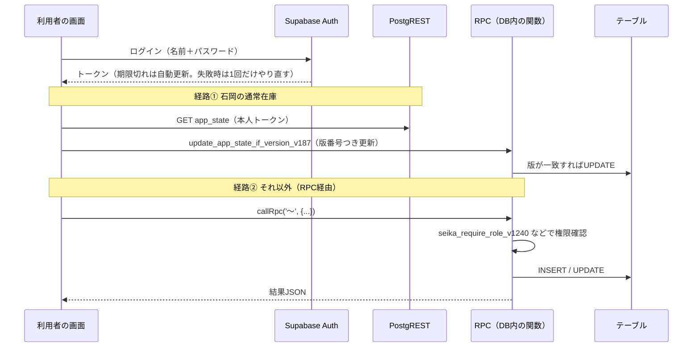

# SEIKA＋ 開発記録・仕様書

石岡青果センター・本社工場 在庫管理アプリ

| 項目 | 内容 |
|---|---|
| 対象バージョン | v1.199-c130（2026-11-19 作成分。c127 以降の変更は 1.4 の表を参照） |
| 本書作成日 | 2026-09-02（初版・v1.192）／2026-11-19 改訂 |
| 作成方法 | 初版：v1.192 の `index.html` と開発チャット（2026-07-08〜09-01）を解析。改訂：main（PR #75 マージ後）のファイル実体・`db/` のSQL・テスト・開発チャット（〜2026-11-18）を照合 |
| 想定読者 | 引き継ぐ開発者・情報システム担当・後任の管理者 |

> **改訂の要点（2026-11-19）**
> - 画面は `index.html` 1ファイルではなくなりました。`index.html` は読み込みだけの74行で、本体は `js/`（26ファイル）と `css/`（12ファイル）に分かれています。
> - 役割は5種類から**11種類**（石岡7・本社4）になりました。
> - ログインは**Supabase Auth**（ログイン中の本人のトークン）で通信する方式に変わりました。
> - **本社工場**（入荷・在庫・下処理・日報・歩留まり・伝票）が加わりました。
> - 納品は「ファイル差し替え」ではなく、**ブランチ → PR → 平田さんがマージ**の流れになりました。自動チェック（`tests/run_all.py`）が必須です。
> - SQLは `db/` に連番で保管します（2026-10 の基準定義＋001〜054）。

---

## 0. 最初に読む人へ（3分で全体像）

**SEIKA＋は、青果センターの在庫を全員が同じ画面で見て、仕入れ担当者への過不足連絡を自動化するために作った社内アプリです。** 現在は石岡青果センターに加えて、本社工場の入荷・在庫・下処理にも使っています。

技術的には、次の3つを押さえれば動きが分かります。

1. **画面は素のHTML/CSS/JavaScript**です（フレームワーク・ビルドなし）。`index.html` は外枠だけで、処理は `js/01〜26` を**番号順に読み込み**ます。後の番号のファイルが前の関数を上書きすることがあります。
2. **データはSupabase（PostgreSQL）**にあります。石岡の通常在庫は `app_state` の1行JSONに入っています。QRロット・品質評価・棚卸し・本社などは、専用テーブルとRPC（DB内の関数）で扱います。権限はDB側で確認します。
3. **公開はGitHub Pages**です。`kk-seki/seika-plus` の `main` にマージされると、そのまま本番に出ます。

**引き継ぎで一番ハマるのがこれです。**

> 関数名・RPC名・テーブル名に付いている `v188` `v1159` `v1500` `v1199c117` などは、**その機能が入った版の番号**です。
> 古い世代も消さずに残っています。さらに、後から読み込むファイルで `window.〜` を差し替えている箇所が多くあります。
> **直す前に必ず `js/` 全体を検索して、最後に有効になっている定義を特定してください。**（詳細は 5.1）

---

## 1. アプリの目的と概要

### 1.1 なぜ作ったか（当初の課題）

開発の出発点は、2026-07-08 のこの一言でした。

> 「作りたいのは在庫管理についてで、適正在庫を設定して過不足があるとLINEと連動して仕入れ担当者に連絡が行くシステムを作りたい。」

| 当時の課題 | 具体的に何が問題だったか |
|---|---|
| 連絡のタイムロス | 仕入れ担当への在庫過不足の連絡を、毎回LINEに**手打ち**していた |
| 抜け漏れ | 手打ちだと「多い／少ない」の品目が抜ける |
| 個人差 | 判断する人によって報告内容がばらつく |
| 判断の不安 | 仕入れ担当者が在庫の実態を確認できず、発注判断が読みになる |
| 費用 | 既存の有料システムの月額費用を抑えたい |

**このアプリの目的は「在庫を記録すること」ではなく、「仕入れ判断に必要な情報を、抜けなく・個人差なく・すぐ届けること」です。** 記録は手段です。機能を足すかどうかは、この目的に照らして判断してください。

### 1.2 基本情報

| 項目 | 内容 |
|---|---|
| アプリ名 | SEIKA＋（セイカプラス）※「青果」と「成果」をかけた命名。2026-07-14 決定 |
| 利用拠点 | 石岡青果センター（2026-08〜本格運用）、本社工場（2026-09〜段階導入。下処理は2026-11〜） |
| 利用者 | 石岡の社員・仕入れ担当者・営業・事務員・総務、本社の社員・事務・荷受け・下処理班（共用アカウント） |
| 端末 | スマートフォン中心（iPhone / Safari）。本社の下処理はタブレット＋タッチペン |
| 提供形態 | PWA（ホーム画面に追加）／ブラウザ |
| 公開URL | `https://kk-seki.github.io/seika-plus/` |
| ソース | GitHub `kk-seki/seika-plus`（デフォルトブランチ `main`・Public） |
| データベース | Supabase プロジェクト `ishioka-inventory`（PostgreSQL・東京リージョン・Freeプラン） |
| 費用 | 現状ゼロ円（GitHub Pages・Supabaseの無料枠） |

### 1.3 使用技術

| 層 | 使っているもの | 補足 |
|---|---|---|
| 画面 | 素のHTML / CSS / JavaScript | `index.html`（74行）＋ `js/` 26ファイル（約2.5MB）＋ `css/` 12ファイル |
| PWA | `sw.js` ＋ `manifest.webmanifest` | キャッシュ名は `seika-static-v1.199-c131-r1`（変更のたびに上げる） |
| DB | Supabase（PostgreSQL）＋ PostgREST ＋ RPC | 業務ロジックと権限チェックはDB側の関数に置く |
| 認証 | Supabase Auth（パスワード方式・トークン自動更新） | ログイン画面は名前を一覧から選ぶ（`list_login_users_v1241`） |
| ファイル保管 | Supabase Storage バケット `qr-quality-photos` | 品質評価の写真（署名付きURLで表示） |
| ホスティング | GitHub Pages | mainへのマージで自動公開 |
| 自動チェック | GitHub Actions「自動チェック」（`.github/workflows/smoke.yml`） | Playwright＋Chromiumで `tests/run_all.py` を実行。上限15分 |
| 外部ライブラリ（`vendor/` に同梱） | `xlsx-js-style-1.2.0` / `exceljs-4.4.0` / `html5-qrcode-2.3.8` / `html2canvas-1.4.1` / `jspdf-2.5.1` | CDNは使わない（外部障害・社内ネットワーク制限の対策） |

### 1.4 開発の経緯（時系列）

| 時期 | 出来事 | 何が決まったか |
|---|---|---|
| 2026-07-08 | 開発開始 | 在庫管理＋LINE連絡という原型。**現在庫を入力する方式**を選択 |
| 07-09 | Supabase導入 | 全員が同じ在庫を見るためクラウド化。LINEの自動送信は断念し、**報告文を作って人が貼る**方式に |
| 07-14 | 名称を **SEIKA＋** に決定 | GitHubアカウントを `kk-seki` へ移行 |
| 07-15 | QRロット管理の構想 | ロット単位で入庫→QR用紙を貼る→QRで出庫 |
| 07-21 | v1.49ベースで作り直し | 印刷HTMLに `<script>` を入れない方針を確立 |
| 07-30 | セット業務のルール確定 | 仮押さえ→2人確認→確定 |
| 08-10 | 利用者説明会 | **本格運用の開始点** |
| 08月 | 品質評価・PWA・トリミング・Web Push・世代バックアップ・月末棚卸し | v1.101〜v1.192 |
| 09-05 | v1.199「認証経路の切り替え」 | 通信をログイン中の本人のトークンで行う方式へ（以後の版番号は v1.199 に固定） |
| 09〜10月 | 認証の仕上げ・本社第1〜2段階・伝票発行・分析・適正在庫の週次見直し | `db/001〜041` |
| 10月 | `db/` を整理 | 2026-10 時点の定義を `000_基準_2026-10.sql` にまとめ、以後は連番で保管 |
| 11-05 | 開発担当の引き継ぎ（AI） | 第6回アップデート回覧、権限別マニュアル11冊 |
| 11-05〜07 | 構造の整理 | 本体を `js/` `css/` に分割、重複定義の整理、保存・同期テストの追加 |
| 11-08〜16 | 本社の出庫入数・在庫表印刷・仕入れ担当者変更・QR出庫数の当日訂正・本社下処理（訂正・休憩・同時製造・日報後入力・サイン・パレット/基単位・箱の半端・確定前削除） | c106〜c126、`db/042〜051` |
| 11-18 | c127（PR #75） | 本社画面を目的別に整理、在庫を2入口に、品目別の日量、網コンテナ種類の設定 |
| 11-19 | c128・c129（PR #76・#77） | 仕様書の改訂、`<title>`・お知らせ・下処理ガイドの修正 |
| 11-19 | c130 | 仕入先・単協マスタの正式化（表記の統一）、GAP一覧の取り込み・QR入庫での自動入力・期限一覧、伝票のGAP表示、荻沼の伝票（`db/052`） |
| 11-19 | c131 | GAP一覧の取り込みが保存できない不具合（WHERE のない DELETE）を修正。GAP一覧の名前を、ロットの単協名のほか仕入先にも当てはめる（`db/053`） |
| 11-19 | c132 | データベースの点検の整理（重複索引の削除、使わない関数を直接呼べなくする、一時バックアップ表を archive へ）。テストの時間帯依存を修正（`db/054`） |

**版番号の決まり**：v1.199 で固定しています（指示がない限り上げない）。変更ごとに作業番号 `cNN` を付け、コミット名を「v1.199-cNN 内容」にします。`sw.js` のキャッシュ名（`-c127-r1` の部分）は毎回上げます。

### 1.5 設計判断の記録（なぜこうなっているか）

**ここを知らずに"改善"すると、過去に解決した問題を再発させます。**

| 判断 | 採用した形 | 見送った案と理由 |
|---|---|---|
| 石岡の通常在庫 | **今ある数を直接入力**（入れ数×ケース数＝kg）。出庫は記録しない | 入出庫の積み上げ。現場が「今ある数を入れる方が早い」と判断。差し引き管理はQR在庫が担う |
| LINE連絡 | **アプリが報告文を作る→人がLINEへ貼る** | 完全自動送信。LINE Notify終了済みで、サーバー常設の費用・保守が増えるため |
| データ保存 | **Supabase（クラウド）** | 端末内保存では全員が同じ在庫を見られない |
| 通常在庫の持ち方 | **`app_state` の1行JSON** | 正規化。改版速度を優先した（4.3のトレードオフあり） |
| 業務ロジックの置き場所 | **できるだけDBのRPC側** | JS側だけだと画面を書き換えて迂回できる |
| 認証 | **Supabase Auth**。ログイン画面は名前を選んでパスワード入力 | 当初はアプリ独自の `users` 管理だったが、v1.199〜で本人トークン方式へ移行。現場にメール運用がないため、名前選択の形は維持 |
| 本社下処理班 | **共用アカウント＋入力者のサイン必須** | パートさんに個別アカウントを作らない運用のため、誰が入力したかはサインで残す |
| フレームワーク | **使わない** | ビルド環境が必要になり、保守が難しくなるため |
| 古い関数の扱い | **すぐには消さない**。整理は検索で「呼ばれていない」と確かめてから | 稼働中の業務を止めないことを優先 |

---

## 2. システム全体の構成

### 2.1 構成図



### 2.2 ファイル構成（リポジトリ）

```
seika-plus/
├── index.html            ← 外枠（74行）。css/ と js/ を順番に読み込むだけ
├── js/                   ← 画面と処理（番号順に読み込み。後のファイルが前を上書きする場合あり）
│   ├── 01-events.js        画面のイベント
│   ├── 02-core.js          共通（設定・通信・保存・ログイン・石岡の主要画面）
│   ├── 03-inventory.js     石岡の在庫・QR・品質・棚卸し・廃棄・トリミング・帳票など
│   ├── 04-honsha.js        本社（入荷・在庫・下処理・日報など）
│   └── 05〜26-cNN-*.js     作業番号ごとに追加した機能（QR出庫、伝票、分析、適正在庫の見直し、
│                           在庫表印刷、仕入れ担当者の変更、出庫訂正、カメラ再試行、下処理日報など）
├── css/                  ← 見た目（01-base〜12-honsha）
├── sw.js                 ← Service Worker（キャッシュ名を毎回上げる）
├── manifest.webmanifest
├── release-notes.json    ← アプリ内のお知らせ（現在は v1.199 の内容のまま）
├── vendor/               ← 外部ライブラリ（5ファイル）
├── icons/
├── db/                   ← SQL（000_基準 ＋ 001〜054 の連番、README.md に実行手順）
├── tests/                ← 自動チェック（run_all.py ほか46本）
├── DOCS/                 ← 本書、下処理の使い方PDF
└── .github/workflows/smoke.yml ← 自動チェックの設定
```

> **注意**：`index.html` の `<title>` は「v1.179 棚卸し在庫反映版」のままです。画面の版表示は `sw.js` の `APP_VERSION`（v1.199）を基準にしてください。

### 2.3 読み込みの順番と上書き

- `js/` は `index.html` に書かれた順（01→26）で読み込まれます。
- 後のファイルが `window.〇〇=…` で前の関数を差し替えるため、**同じ名前の関数でも、最後に読み込まれた定義が有効**です。
- 2026-11 の整理で重複定義は大きく減りましたが、なくなってはいません（2026-11-19 時点で、エラーを黙って握りつぶす `catch(e){}` が約170か所、`MutationObserver` が15か所あります）。

---

## 3. 主要な機能一覧

### 3.1 役割（権限）

全11役割です。ホーム画面は役割ごとに変わります。**画面の出し分けは見た目だけで、実際の権限はDB側で確認します。**

| 拠点 | 役割（コード） | 表示名 | 主な役割 |
|---|---|---|---|
| 石岡 | `admin` | 管理者 | 全機能。ユーザー管理、確定・削除、価格設定 |
| 石岡 | `worker` | 青果社員 | 通常在庫・QR在庫・廃棄・棚卸し・品質評価の入力。品目設定・仕入れ担当者の変更 |
| 石岡 | `buyer` | 仕入れ担当者 | 発注判断、適正在庫（週次見直し）、低評価の確認。QRと廃棄は閲覧 |
| 石岡 | `sales` | 営業担当者 | 在庫確認、廃棄単価・金額管理 |
| 石岡 | `clerk` | 事務員 | 廃棄記録、単価、Excel作成 |
| 石岡 | `viewer` | 閲覧者 | 在庫・QRロット・廃棄一覧の閲覧 |
| 石岡 | `office_viewer` | 総務（閲覧） | 閲覧 |
| 本社 | `hq_worker` | 本社社員 | 受け入れ・確定、下処理の確認・確定・訂正、在庫入力、棚卸し、マスタ・スタッフ登録、集計・Excel |
| 本社 | `hq_clerk` | 本社事務 | 本社の在庫・集計の閲覧、Excel |
| 本社 | `hq_receiver` | 本社 荷受け担当者 | 品質評価と確定、貼り紙の印刷、在庫入力、原料出し・下処理への出庫 |
| 本社 | `hq_prep` | 本社 下処理班 | 下処理と作業時間の記録（共用アカウント・サイン必須）。金額は表示しない |

役割ごとの詳しい操作は、アプリ内の「操作ガイド」と「権限別操作マニュアル」（PDF、全11役割）を参照してください。
トレース表は、本社の下処理班と荷受け担当者には表示しません（`db/040`）。

### 3.2 機能一覧（石岡）

| 分類 | 機能 | 概要 |
|---|---|---|
| 在庫 | 通常在庫入力 | 品目ごとに入れ数×ケース数。同じ品目で複数の入れ数に対応 |
| 在庫 | 在庫表・印刷 | 第2冷蔵庫／第3冷蔵庫／その他（片岡）。QR品目もkgで1つにまとめ、在庫のある品目だけをA4に自動で収める |
| 在庫 | 特殊在庫 | 鉄コンテナ・網コンテナ・パレット。**網コンテナは種類の追加・名称変更・使用停止が可能**（c127） |
| 判定 | 発注候補・過多品目 | 適正在庫と比べる。QR品目も含めて表示 |
| 判定 | 適正在庫の週次見直し | 仕入れ担当者が見直し、記録と変更履歴を残す（`db/037・038`） |
| 連絡 | 在庫報告コピー | 「過多」「不足」を文章にしてLINEへ貼る |
| QR | ロット登録・QR貼り紙 | 1パレット/ケース数の表記、規格別ロット。**仕入先・単協名はマスタの正式名から選ぶ**（マスタにない名前は確認して登録。別名は自動で正式名に直す）（c130） |
| QR | 仕入先・単協マスタ | 正式名・別名・非表示。管理者は、ロットに入っている表記を正式名にまとめ、過去のロット・履歴・本社入荷記録の表記も直せる（`db/052`、c130） |
| QR | GAP一覧（管理者） | 単協名・仕入先＋品目ごとの認証区分（JGAP/GGAP/ASIAGAP）と有効期限をExcelで取り込み（単協名で当たる行が先、なければ仕入先）（全部置き換え・差分確認・エラー一覧）。QR入庫で自動入力、在庫が残るロットへさかのぼり、期限切れ・30日以内の一覧（`db/052`、c130） |
| QR | 出庫・廃棄・実数調整・ロット訂正 | 連続スキャン、作業の保留。**QR出庫数の当日訂正**（埼玉・深谷。実数調整の後も可、`db/043・044`） |
| QR | 保管目安・場所移動 | 保管期間アラート、特別期間、場所移動 |
| 品質 | 品質評価 | 写真付き。低評価は担当の仕入れ担当者へ通知 |
| 加工 | トリミング・日報・歩留まり | 使用量と出来高を記録。**在庫は減らさない** |
| 廃棄 | 廃棄記録・週次廃棄レポート | 仕入れ価格から金額を出す |
| 棚卸し | 月末棚卸し・セクション別 | 月末時点のスナップショットと実数を突き合わせ、差異だけを履歴へ |
| 帳票 | Excel・伝票 | 月次Excel、伝票発行（埼玉・深谷・本社工場・荻沼。総重量と入数。**GAPを表示**、荻沼は本社工場と同じ「入荷日＋便ごと」の納品書）（c130） |
| 分析 | 在庫・出庫の分析 | **品目別の日量**（出庫した日の平均／期間全日の平均、kg不明の区別）（c127） |
| 管理 | 仕入れ価格表・品目設定・仕入れ担当者の変更 | 品目設定は管理者と青果社員。仕入れ担当者はフルネーム表示 |
| 管理 | ユーザー管理・不具合報告・お知らせ | |
| 基盤 | PWA・Web Push・自動バックアップ | |

### 3.3 機能一覧（本社）

c127 でホームを目的別の入口にまとめました。下処理の入口と動きは別です。

| 入口 | 中の機能 |
|---|---|
| 入荷・受け入れ | 入荷待ち、QR読み取り、本社直接入荷（石岡経由／本社で入力） |
| 在庫を見る | **在庫表**（品目×日付）、**品目別在庫・ロット一覧**（品目を選ぶ→合計→ロット→詳細。文字検索は補助） |
| 在庫を操作する | 在庫入力、原料出し、廃棄、棚卸し |
| 履歴・帳票・設定 | 入出庫履歴、品質評価、仕入れ価格表、Excel、品目設定、スタッフ・マスタ |
| 下処理 | 下記 |

**本社 下処理の流れ（c116〜c126）**

1. 作業開始：仕掛品を選ぶ（同じ品目なら複数選択可。マスタにないものは手入力可）。スタッフは班ごとに折りたたんだ一覧から複数選択。
2. 使用原料：1パレット・1基ずつQRを読み、「全量使った／半端が残った」を選ぶ。全量ならkgを自動で入れる（ケースは量目×ケース数、大型容器はその1基のkg）。半端なら残りのkgを入れる。
3. 休憩・中断：休憩に入らない人を選べる。あとから休憩の追加、抜けた・入った時刻の修正ができる。
4. 終了：入力内容の確認画面を1回挟み、入力者がサインする。
5. 社員の確認：本社社員・管理者が確定する。不備があれば訂正するか、下処理班に差し戻す。確定後も社員は時刻を訂正できる。
6. 廃棄は「使用原料－出来高」の自動計算を初期値にし、手入力で直せる。仕掛品の使用期限は2日。清掃は日報に入れない。
7. 端末を取り合うため、日報はあとから入力できる。確定前の作業は、下処理班・本社社員・管理者が削除できる。

---

## 4. データの流れ

### 4.1 通信の経路



- 2026-10 の認証の仕上げ（`db/005`）で、**ログインしていない状態で実行できる関数・表はなくしました**（ログイン画面の名前一覧だけは例外）。
- 書き込みの権限チェックもDB側に追加しています。新しいRPCを作るときも、必ず役割の確認を入れてください。

### 4.2 主なテーブル

全体の定義は `db/000_基準_2026-10.sql`（2026-10-04 時点）と、その後の `db/001〜054` にあります。

| 区分 | 主なテーブル |
|---|---|
| 石岡 通常在庫・設定 | `app_state`、`app_settings`、`app_state_backup_slots_v1167`・`app_state_backup_blobs_v1167`（世代バックアップ） |
| 利用者 | `profiles`（役割）、`app_admins` |
| QR | `qr_lots`、`qr_lot_movements`、`qr_scan_logs`、`qr_storage_locations`、`qr_storage_limits_v1250`、`qr_lot_grades_v1300`、`qr_party_names_v1280`、`qr_party_merge_log_v1199c130`、`qr_gap_certs_v1199c130`、`qr_slip_adjust_v1199c86` |
| 品質 | `qr_quality_evaluations`、`qr_quality_photos`、`quality_push_queue_v1144`、`web_push_subscriptions_v1144` |
| 廃棄・加工・価格 | `waste_records`、`trimming_jobs`（＋`_lots`・`_outputs`）、`trim_output_candidates_v1680`、`purchase_prices` |
| 棚卸し・月次 | `qr_inventory_sessions`、`inventory_records`、`qr_lot_monthly_snapshots`、`qr_monthly_exports`、`seika_monthly_archives` |
| 適正在庫 | `optimal_stock_change_logs_v1199c89` |
| 本社 | `hq_lots_v1400`、`hq_lot_movements_v1400`、`hq_destinations_v1400`、`hq_stock_counts_v1500`、`hq_stocktakes_v1500`、`hq_staff_v1500`、`hq_teams_v1500`、`hq_works_v1500`、`hq_work_members_v1500`、`hq_work_materials_v1500`、`hq_work_material_units_v1199c122`、`hq_work_pauses_v1199c116`、`hq_prep_masters_v1500`、`hq_prep_standards_v1199c117`、`hq_prep_signatures_v1199c121`、`hq_prep_operations_v1199c116/c120`、`hq_prep_report_operations_v1199c117`、`hq_waste_v1500`、`hq_settings_v1500`、`hq_monthly_archives_v1690` ほか |
| 監査・控え | `user_admin_audit_logs`、`seika_function_backup_v1240`（変更前の関数定義）など |

> FIFO関連（`seika_fifo_*_v1136`）は作ってありますが、現場では使わない方針です（2026-08-17）。

### 4.3 `app_state` 方式の注意

石岡の通常在庫は、正規化されたテーブルではなく**1つのJSON**です。

- 利点：スキーマ変更なしで項目を足せる。
- リスク：後勝ちで上書きすると他人の更新が消える。そのため **`update_app_state_if_version_v187`（版番号の照合）** で保存します。
- 保存は「端末のキュー → 少し待って送信」の流れで、成功の条件が複数あります。保存・同期を触ったら、必ず `tests/sync.py` を含む全体チェックを回してください。
- 未同期のデータは、再入力せず同じ端末から再送します（画面上部が「クラウド保存済み」になることを確認）。

> **過去の重大事故（v1.192で修正）**：保存データを組み立てる処理が、条件によって棚卸しデータを削除していました。**`app_state` へ保存する処理を変えるときは、その役割が触っていない領域を落としていないか必ず確認してください。**

### 4.4 月末棚卸し

対象月末の在庫をスナップショット → 実数を入力（QRはスキャン） → 差異の理由を入れて確定 → 差異だけを月末日付で履歴へ反映 → Excel出力（デスクネッツ文書管理へ保管）。差異ゼロでも確定できます。確定後の修正は管理者が差分を追加します。

### 4.5 容量とバックアップ

Supabase無料枠：DB 500MB・Storage 1GB・転送5GB/月。

- 2026-08-31 に旧バックアップ方式（`app_state_backups`）の肥大でDBが238MBになり、整理と `vacuum (full, analyze)` で32MBまで減らしました。
- その後、自動バックアップの保存期間と詰め直し（`db/030・031`）、通信量を減らす改修（`db/014・015`）を入れています。
- **現在の容量は本書では未確認です。** 月1回、Supabase の Usage 画面で確認してください。

---

## 5. 今後のメンテナンス・修正時の注意点

### 5.1 ★最重要：版番号つきの名前と上書き

```
v188Home / v192DownloadExcel                     ← JS側（v1.88、v1.192で追加）
list_qr_quality_evaluations_v1102 → _v1159       ← RPC（作り直すたびに番号が増える）
hq_works_v1500 / hq_work_pauses_v1199c116        ← 本社のテーブル（版＋作業番号）
```

**必ず守る手順：**

1. 直したい機能の名前で **`js/` 全体を検索**する（`grep -rn 名前 js/`）。
2. 同じ系統の関数が複数あれば、**最後に読み込まれるファイル**と `window.〜` への代入を確認し、実際に有効な定義を特定する。
3. その定義だけを直す。古い世代は、呼ばれていないと確かめるまで消さない。
4. RPCは `db/` の後の番号のSQLで作り直されていることがある。**最新の番号の定義**を見る。

### 5.2 納品（リリース）の手順

1. 最新の `main` からブランチを作る（例：`c128-内容`）。
2. 修正する。機能を足したり変えたりしたら、**アプリ内の操作ガイドも更新**する。
3. `sw.js` のキャッシュ名を上げる（`-c127-r1` → `-c128-r1` など）。版番号 v1.199 は指示がない限り変えない。
4. `python3 tests/run_all.py` を実行し、すべて成功することを確認する。
5. 1コミット（題名「v1.199-cNN 内容」）にまとめ、`main` 宛てのPRを作る。
6. DBの変更があるときは、`db/` に次の番号でSQLを入れ、`db/README.md` に「SQLが必要か／実行する順番／成功の確かめ方／保管名」の4点を書く。SQLは `BEGIN; … COMMIT;` で包み、末尾で成功確認（`OK` 表示）をする。
7. **平田さんがSQLを本番で実行 → 成功を確認 → PRをマージ**（この順番）。
8. GitHubの「自動チェック」と Pages 公開が緑になったことを確認し、実機で開いて確認する。

> 自動チェックは、PRの段階で準備（Playwrightのインストール）に時間がかかり、15分の上限で止まることがあります。その場合はコードの失敗ではないので、「Re-run jobs」で再実行してください。

### 5.3 やってはいけないこと

| やってはいけない | 理由 |
|---|---|
| `app_state` をSQLで直接UPDATEする | 版番号の照合を迂回し、他の人の更新を消す |
| 印刷用HTMLの中に `<script>` を書く | 閉じタグが本体のJavaScriptを途中で終わらせ、画面にコードが出る |
| 権限や在庫計算をJS側だけで行う | 画面を書き換えれば迂回できる。DB側で確認する |
| `sw.js` のキャッシュ名を変えずに公開する | 利用者に更新が届かない |
| 石岡の通常在庫に出庫機能を足す | 通常在庫は「今ある数」を入れる方式。差し引きはQR在庫の役割 |
| トリミングで在庫を減らす | トリミングは歩留まりの記録 |
| 現在庫を超える出庫を許す | DB側で禁止している。迂回しない |
| 大量削除の後にVACUUMを省く | 容量が戻らない |
| 認証情報（秘密キー・パスワード）をコードやチャットに書く | GitHubの履歴・チャット記録に残る |
| 古い世代の関数をまとめて削除する | どこから呼ばれているか確かめずに消すと、特定の操作だけ壊れる |

### 5.4 過去に起きた不具合と教訓

| 事象 | 原因 | 教訓 |
|---|---|---|
| 画面にソースコードがそのまま表示される | 印刷HTML内の `</script>` | 印刷HTMLに `<script>` を入れない |
| 在庫表から通常在庫の行が全部消えた | 正規化処理の条件式のミス | 保存系・正規化系を直したら実データで確認 |
| 進行中の棚卸しが再読込で消える | 保存データの組み立てで棚卸し領域を落としていた | 4.3参照 |
| 出庫履歴が開けない | SQLの `WITH` 句のスコープ | RPCを直したらSQLエディタで実行して確認 |
| DBが無料枠の48%まで肥大 | 停止したはずのバックアップ行が蓄積 | 4.5参照 |
| 同じ人が別人として二重登録・設定画面に同じ人が2人 | 登録名と候補名（略称）の不一致 | 人名はフルネーム（アカウント名）に統一する |
| 在庫表を開くのに5〜8秒かかった | 開くたびの重い集計（c109で改善） | 画面を足したら開く速さも確認する |
| カメラを一度拒否すると二度と起動できない | 拒否後の再試行の作りがなかった（c115で修正） | iPhoneの権限の動きを実機で確認する |
| QRの読み間違い・スタッフQRの連続読み取り | カメラが開きっぱなし（c118で対策） | カメラは1回ずつ開く。スタッフは一覧から選ぶのを基本にする |
| 本社の印刷で単協名が枠からはみ出す | 単協と仕入先の両方を印刷していた | 印刷用紙には単協名を入れず、仕入先を入れる |
| PRの自動チェックが止まる | 準備工程が15分の上限に達した | 再実行する（5.2参照） |

### 5.5 修正時のチェックリスト

- [ ] 修正対象の名前で `js/` 全体と `db/` を検索し、**有効な定義**を特定した
- [ ] `window.〜` の差し替えがないか確認した
- [ ] `app_state` の保存処理を触った場合、他の領域を落としていないか確認した
- [ ] DB変更がある場合、`db/` に連番で入れ、README に4点を書いた
- [ ] アプリ内の操作ガイドを更新した
- [ ] ホームのボタンの色が、ほかのボタンと重ならない
- [ ] `sw.js` のキャッシュ名を上げた
- [ ] `python3 tests/run_all.py` がすべて成功した
- [ ] 結果は「仮のデータで確認」と「本番で確認」を分けて報告し、確かめていないものは「未確認」と書いた
- [ ] 印刷・Excelを触った場合、実際に出力して開いた

### 5.6 定期メンテナンス

| 頻度 | 作業 |
|---|---|
| 月次 | 棚卸しExcelをデスクネッツ文書管理へ保管 |
| 月次 | Supabase の Usage でDB容量を確認（目安：100MBを超えたら整理を検討） |
| 月次 | `qr_scan_logs`・バックアップ表の行数を確認 |
| 四半期 | 利用者の棚卸し（退職者のアカウントを無効にする） |
| 随時 | 適正在庫の見直し（仕入れ担当者・週次） |

### 5.7 引き継ぎに必要なアカウント

| 対象 | 用途 | 備考 |
|---|---|---|
| GitHub `kk-seki` | ソース管理・公開・PRのマージ | `seika-plus` の書き込み権限 |
| Supabase `ishioka-inventory` | DB・RPC・Storage・Auth | SQLエディタが使えること |
| SEIKA＋の管理者アカウント | アプリ内のユーザー管理 | |
| Web Push の鍵 | 通知の維持 | 設置場所は**要確認** |

> **セキュリティ上の注意**
> - 開発初期に、HTMLへパスワードを平文で書いていた時期があります（GitHubの履歴に残っています）。
> - 2026-07-09 に、Supabaseの秘密キー（`sb_secret_…`）を開発チャットに貼ったことがあります。再生成した記録はありません。**再生成を推奨します**（アプリは公開キーだけを使うため、影響は小さい見込み。未確認）。
> - `js/02-core.js` などに含まれるSupabaseの公開キーは公開前提です。その分、**RLS（行レベルセキュリティ）とRPCの権限チェックが守りの要**です。ここを緩めないでください。

### 5.8 開発の進め方（AIとの分担）

**仕様と実用性の判断は人（平田さん）が持ち、実装はAIが担う**分担です。

| 担当 | 内容 |
|---|---|
| 人 | 業務要件、画面構成の判断、現場での検証、優先順位、SQLの本番実行、PRのマージ |
| AI | 調査、実装、テスト、SQL作成、PR作成、資料作成 |

**進め方の決まり（平田さんの指示）**

1. 不明点は「選択肢＋推奨案」で短く質問する。「全て推奨で」「Aで」と返ったら、確認を挟まずPR作成まで進める。
2. 依頼の範囲外の仕様・文言・構成は勝手に変えない。変えたいときは先に提案する。
3. 結論を先に、専門用語を避けて平易に書く。
4. ファイルを添付するのは、SQLなど**マージで反映されないものだけ**。アプリ・テスト・ZIPは添付しない。
5. ツールの呼び出しややり取りを無駄に増やさない。
6. 業務ルール（何が正しい在庫か、誰が確定してよいか）はAIが決めない。

---

## 6. 困ったときの調べ方

| 知りたいこと | 調べ方 |
|---|---|
| ある機能のコードはどこ？ | `grep -rn 機能名 js/`。本社は `04-honsha.js` と `cNN` のファイル |
| RPCの最新の定義は？ | `grep -ln 関数名 db/*.sql` で一番大きい番号を見る |
| いま公開されている版は？ | `sw.js` の `CACHE_NAME`、GitHubの Actions（pages build and deployment） |
| DBのエラー原因は？ | Supabase のSQLエディタで該当RPCを実行してエラー文を読む |
| 更新が反映されない | キャッシュ名を上げたか確認 → 端末でリロード |
| 白画面になった | ブラウザの開発者コンソールでエラーを確認。`js/` の読み込み失敗を疑う |
| 誰がいつ何をしたか | アプリ内の履歴、`qr_lot_movements`、`hq_lot_movements_v1400`、監査表 |
| DB容量 | Supabase → Reports → Usage |

---

## 7. 用語集

| 用語 | 意味 |
|---|---|
| 適正在庫 | 品目ごとの最低・上限のkg。過不足の判定基準 |
| 入れ数・量目 | 1ケースあたりの重量（kg） |
| 通常在庫 | 今ある数を直接入れる在庫（石岡：第2冷蔵庫・第3冷蔵庫・その他（片岡）） |
| QR在庫 | ロットごとにQRを貼り、入出庫を差し引きで管理する在庫 |
| ロット | 入荷の単位。QRを貼る対象 |
| 大型容器・基 | 鉄コンテナ・網コンテナなど。1基ごとに重量を持つ |
| 仕掛品 | 本社の下処理でできる中間品。使用期限は2日 |
| 出来高 | 下処理・トリミングでできた量 |
| トリミング | 加工での使用量と出来高の記録。在庫は減らさない |
| 契約産地 | 中央園芸・茨城中央園芸・飯山中央市場・中央VFS・市場商事（市場ではない） |
| 作業番号 cNN | v1.199 以降の変更ごとの番号（例：c127） |
| RPC | Supabase（PostgreSQL）内の関数 |
| RLS | 行レベルセキュリティ。DB側で誰がどの行を触れるかを決める |

---

## 8. 本書の保守

- 保管場所：リポジトリの `DOCS/`。
- 更新するとき：テーブル・RPC・画面・役割・運用ルールを追加・変更したとき。
- 記載と実体が違ったら、**実体が正**です。本書を直してください。

**まだ載っていない領域（今後追記）**

- Web Push の鍵・Edge Function の設置場所と更新方法（要確認）
- RLSポリシーの一覧と、各テーブルの想定アクセス範囲
- 現行世代のRPCの一覧（引数・戻り値）
- 障害時の連絡と復旧の手順（バックアップからの戻し方）
- `release-notes.json` と `index.html` の `<title>` が古いままの件（直すかどうか要判断）
